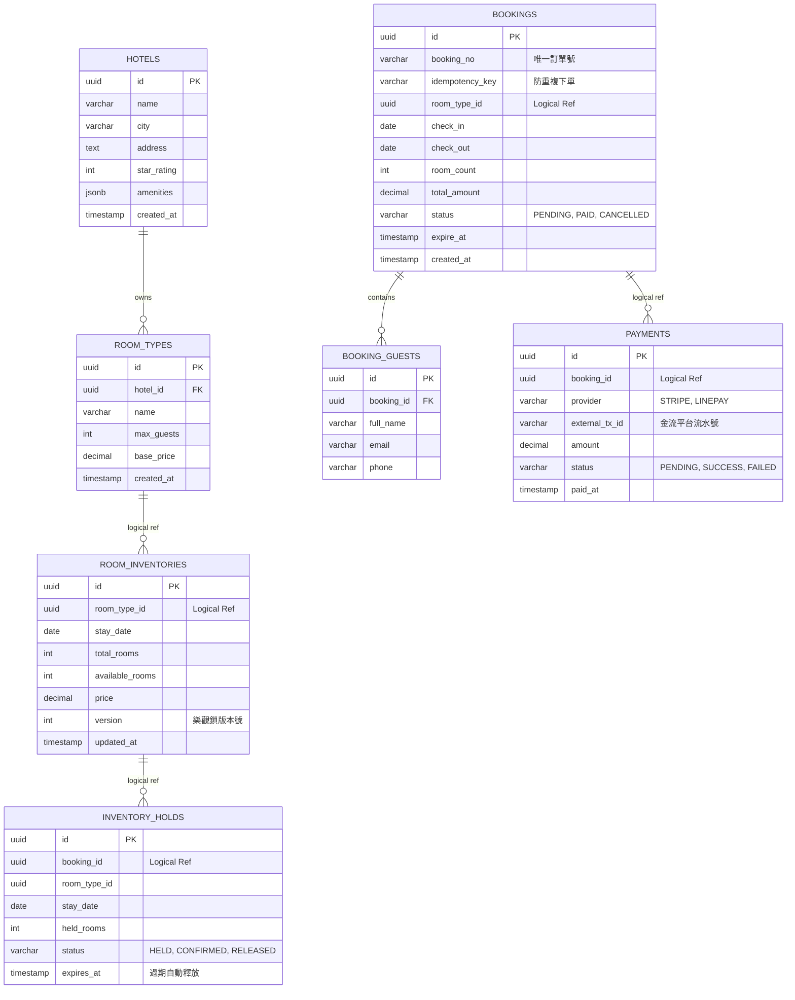

# 資料庫架構設計規格書 (Database Schema Design)

> **專案名稱**：OTA Hotel Booking (Modular Monolith)  
> **目標資料庫**：PostgreSQL 16+ (具備強大 JSONB、交易隔離與行鎖機制)  
> **模組隔離原則**：在同一資料庫實例中，各模組採用獨立的 **PostgreSQL Schema**（或資料表前綴）進行實體隔離，各模組資料表嚴格禁止跨模組外鍵 (Foreign Key) 與跨模組 JOIN，僅保留邏輯關聯 (Logical Reference)。

---

## 1. 模組資料表總覽 (Schema Overview)

| 模組 (Schema) | 資料表 (Table) | 說明 | 高併發關鍵設計 |
| :--- | :--- | :--- | :--- |
| **`catalog`** | `hotels` | 飯店基本資料 | 多欄位複合索引加速檢索 |
| **`catalog`** | `room_types` | 房型規格與容量 | 飯店與房型一對多 |
| **`inventory`** | `room_inventories` | **每日房態與庫存 (核心)** | `version` 樂觀鎖版本號、`UNIQUE (room_type_id, date)` |
| **`inventory`** | `inventory_holds` | **庫存佔位記錄 (15分鐘)** | `expires_at` 索引、支援超時自動釋放 |
| **`booking`** | `bookings` | 訂單主表 | `idempotency_key` 唯一索引防重複下單 |
| **`booking`** | `booking_guests` | 入住旅客資料 | 關聯訂單 |
| **`payment`** | `payments` | 金流交易明細 | 外部支付交易單號唯一鍵 |

---

## 2. 實體關係圖 (ERD)



---

## 3. 資料表詳細定義 (DDL Specification)

### 3.1 Catalog 模組 (Schema: `catalog`)

#### 1. `catalog.hotels` (飯店表)
```sql
CREATE SCHEMA IF NOT EXISTS catalog;

CREATE TABLE catalog.hotels (
    id UUID PRIMARY KEY DEFAULT gen_random_uuid(),
    name VARCHAR(150) NOT NULL,
    city VARCHAR(80) NOT NULL,
    address TEXT NOT NULL,
    latitude DECIMAL(9, 6),
    longitude DECIMAL(9, 6),
    star_rating INT NOT NULL CHECK (star_rating BETWEEN 1 AND 5),
    amenities JSONB DEFAULT '[]'::jsonb, -- e.g. ["WIFI", "SWIMMING_POOL", "PARKING"]
    is_active BOOLEAN NOT NULL DEFAULT true,
    created_at TIMESTAMPTZ NOT NULL DEFAULT CURRENT_TIMESTAMP,
    updated_at TIMESTAMPTZ NOT NULL DEFAULT CURRENT_TIMESTAMP
);

-- 索引優化：常用搜尋維度
CREATE INDEX idx_hotels_city ON catalog.hotels (city) WHERE is_active = true;
CREATE INDEX idx_hotels_star ON catalog.hotels (star_rating);
```

#### 2. `catalog.room_types` (房型表)
```sql
CREATE TABLE catalog.room_types (
    id UUID PRIMARY KEY DEFAULT gen_random_uuid(),
    hotel_id UUID NOT NULL REFERENCES catalog.hotels(id) ON DELETE CASCADE,
    name VARCHAR(100) NOT NULL, -- 如 "豪華雙人海景房"
    bed_type VARCHAR(50) NOT NULL, -- 如 "1 King Bed"
    max_adults INT NOT NULL DEFAULT 2,
    max_children INT NOT NULL DEFAULT 0,
    area_sqm DECIMAL(5, 2), -- 房間坪數/平方公尺
    base_price DECIMAL(10, 2) NOT NULL,
    is_active BOOLEAN NOT NULL DEFAULT true,
    created_at TIMESTAMPTZ NOT NULL DEFAULT CURRENT_TIMESTAMP
);

CREATE INDEX idx_room_types_hotel_id ON catalog.room_types (hotel_id);
```

---

### 3.2 Inventory 模組 (Schema: `inventory` - 高併發核心)

#### 3. `inventory.room_inventories` (每日房態與庫存表)
> **設計重點**：
> 1. `UNIQUE (room_type_id, stay_date)`：確保每一天特定房型只有唯一一筆庫存紀錄。
> 2. `CHECK (available_rooms >= 0)`：**資料庫層級的硬保證，絕對不允許超賣至負數**。
> 3. `version INT`：**樂觀鎖**專用欄位，每次更新時遞增。

```sql
CREATE SCHEMA IF NOT EXISTS inventory;

CREATE TABLE inventory.room_inventories (
    id UUID PRIMARY KEY DEFAULT gen_random_uuid(),
    room_type_id UUID NOT NULL, -- 邏輯關聯 catalog.room_types.id
    stay_date DATE NOT NULL,
    total_rooms INT NOT NULL CHECK (total_rooms >= 0),
    available_rooms INT NOT NULL CHECK (available_rooms >= 0), -- 防超賣核心約束
    price DECIMAL(10, 2) NOT NULL,
    version INT NOT NULL DEFAULT 0, -- 樂觀鎖版本號
    updated_at TIMESTAMPTZ NOT NULL DEFAULT CURRENT_TIMESTAMP,
    CONSTRAINT uq_room_type_date UNIQUE (room_type_id, stay_date)
);

-- 查詢某房型特定日期區間的房態
CREATE INDEX idx_inventories_search ON inventory.room_inventories (room_type_id, stay_date);
```

#### 4. `inventory.inventory_holds` (佔位鎖定紀錄表)
> **設計重點**：旅客點選預訂時，庫存被 Hold 住（15分鐘）。逾期未付透過背景工作排程或事件觸發釋放。

```sql
CREATE TABLE inventory.inventory_holds (
    id UUID PRIMARY KEY DEFAULT gen_random_uuid(),
    booking_id UUID NOT NULL, -- 邏輯關聯 booking.bookings.id
    room_type_id UUID NOT NULL,
    stay_date DATE NOT NULL,
    held_rooms INT NOT NULL CHECK (held_rooms > 0),
    status VARCHAR(20) NOT NULL DEFAULT 'HELD', -- 'HELD', 'CONFIRMED', 'RELEASED'
    expires_at TIMESTAMPTZ NOT NULL, -- 佔位到期時間 (例如 now + 15 mins)
    created_at TIMESTAMPTZ NOT NULL DEFAULT CURRENT_TIMESTAMP
);

-- 快速掃描超時未付佔位 (用於定時釋放庫存任務)
CREATE INDEX idx_holds_expire ON inventory.inventory_holds (status, expires_at)
WHERE status = 'HELD';
```

---

### 3.3 Booking 模組 (Schema: `booking`)

#### 5. `booking.bookings` (預訂主表)
> **設計重點**：
> 1. `idempotency_key` 唯一索引：同一個請求即使按兩次，資料庫直接擋下重覆插入。
> 2. 訂單狀態機：`PENDING_PAYMENT` -> `PAID` -> `CANCELLED` / `COMPLETED`。

```sql
CREATE SCHEMA IF NOT EXISTS booking;

CREATE TABLE booking.bookings (
    id UUID PRIMARY KEY DEFAULT gen_random_uuid(),
    booking_no VARCHAR(32) NOT NULL UNIQUE, -- 業務訂單編號，如 "BK202611030001"
    idempotency_key VARCHAR(64) NOT NULL UNIQUE, -- 前端帶入的防重 UUID
    user_id UUID NOT NULL, -- 旅客 ID
    room_type_id UUID NOT NULL,
    check_in DATE NOT NULL,
    check_out DATE NOT NULL,
    room_count INT NOT NULL DEFAULT 1 CHECK (room_count > 0),
    total_amount DECIMAL(10, 2) NOT NULL,
    currency VARCHAR(3) NOT NULL DEFAULT 'TWD',
    status VARCHAR(30) NOT NULL DEFAULT 'PENDING_PAYMENT',
    expire_at TIMESTAMPTZ NOT NULL, -- 付款截止時間
    cancelled_at TIMESTAMPTZ,
    cancellation_reason TEXT,
    created_at TIMESTAMPTZ NOT NULL DEFAULT CURRENT_TIMESTAMP,
    updated_at TIMESTAMPTZ NOT NULL DEFAULT CURRENT_TIMESTAMP
);

CREATE INDEX idx_bookings_user ON booking.bookings (user_id);
CREATE INDEX idx_bookings_status_expire ON booking.bookings (status, expire_at)
WHERE status = 'PENDING_PAYMENT';
```

#### 6. `booking.booking_guests` (住客資料明細表)
```sql
CREATE TABLE booking.booking_guests (
    id UUID PRIMARY KEY DEFAULT gen_random_uuid(),
    booking_id UUID NOT NULL REFERENCES booking.bookings(id) ON DELETE CASCADE,
    full_name VARCHAR(100) NOT NULL,
    email VARCHAR(150) NOT NULL,
    phone VARCHAR(30) NOT NULL,
    is_primary BOOLEAN NOT NULL DEFAULT true
);

CREATE INDEX idx_booking_guests_booking_id ON booking.booking_guests (booking_id);
```

---

### 3.4 Payment 模組 (Schema: `payment`)

#### 7. `payment.payments` (金流交易表記錄)
```sql
CREATE SCHEMA IF NOT EXISTS payment;

CREATE TABLE payment.payments (
    id UUID PRIMARY KEY DEFAULT gen_random_uuid(),
    booking_id UUID NOT NULL, -- 邏輯關聯 booking.bookings.id
    provider VARCHAR(30) NOT NULL, -- 'STRIPE', 'LINE_PAY', 'ECPAY'
    external_transaction_id VARCHAR(100) UNIQUE, -- 第三方金流的交易序號
    amount DECIMAL(10, 2) NOT NULL,
    currency VARCHAR(3) NOT NULL DEFAULT 'TWD',
    status VARCHAR(20) NOT NULL DEFAULT 'PENDING', -- 'PENDING', 'SUCCESS', 'FAILED', 'REFUNDED'
    failure_reason TEXT,
    paid_at TIMESTAMPTZ,
    created_at TIMESTAMPTZ NOT NULL DEFAULT CURRENT_TIMESTAMP
);

CREATE INDEX idx_payments_booking_id ON payment.payments (booking_id);
```

---

## 4. 高併發情境下的 SQL 執行模式

### 4.1 核心操作一：樂觀鎖扣減庫存 (Optimistic Lock)
當旅客預訂 2026-12-01 ~ 2026-12-03 (兩晚)、1 間房：
```sql
-- 程式先取出該日期目前的 version (假設為 3)
-- 執行扣減並核對 version：
UPDATE inventory.room_inventories
SET available_rooms = available_rooms - 1,
    version = version + 1,
    updated_at = CURRENT_TIMESTAMP
WHERE room_type_id = '...' 
  AND stay_date = '2026-12-01'
  AND available_rooms >= 1
  AND version = 3;
```
> **若 Rows Affected == 0**：代表被其他併發請求搶先搶走，程式拋出 `ConcurrencyException`，可選擇重試或回傳「房間已被搶訂」。

### 4.2 核心操作二：超時佔位自動釋放 (Background Cleanup)
排程任務每 30 秒執行一次：
```sql
-- 1. 找出逾期的佔位
WITH expired_holds AS (
    UPDATE inventory.inventory_holds
    SET status = 'RELEASED'
    WHERE status = 'HELD' AND expires_at < CURRENT_TIMESTAMP
    RETURNING room_type_id, stay_date, held_rooms
)
-- 2. 把庫存歸還給 room_inventories
UPDATE inventory.room_inventories inv
SET available_rooms = inv.available_rooms + eh.held_rooms,
    version = inv.version + 1,
    updated_at = CURRENT_TIMESTAMP
FROM expired_holds eh
WHERE inv.room_type_id = eh.room_type_id AND inv.stay_date = eh.stay_date;
```
