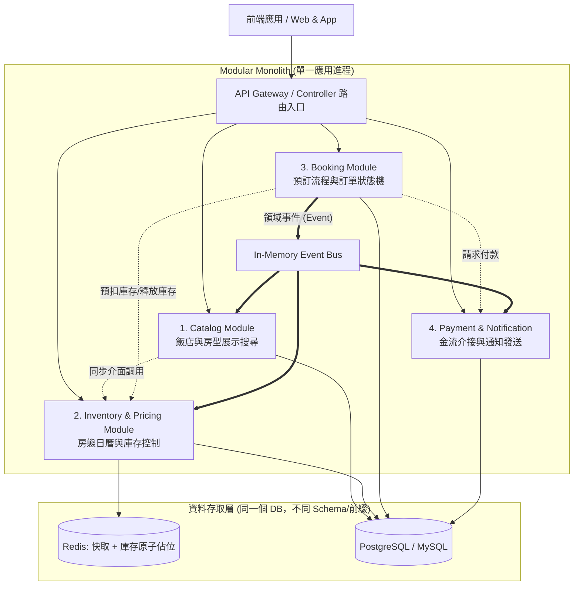
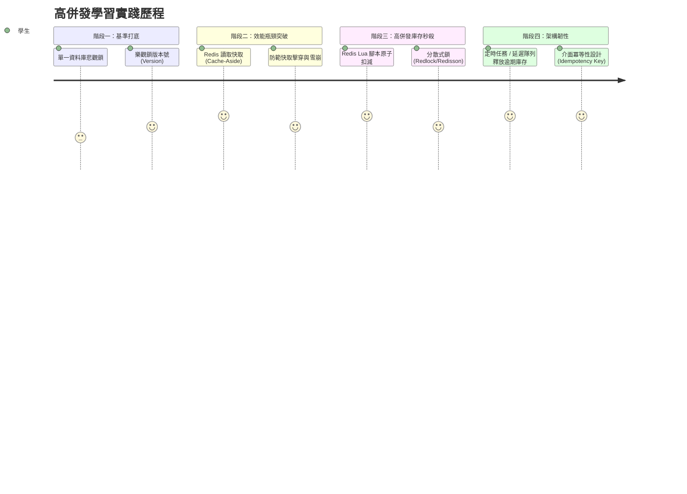

# 軟體需求規格說明書 (Software Requirements Specification, SRS)

> **專案名稱**：OTA (Hotel Booking Platform) 飯店預訂系統  
> **架構風格**：模組化單體架構 (Modular Monolith)  
> **學習與實踐目標**：從零掌握高併發 (High Concurrency)、庫存防超賣、快取設計與領域驅動邊界劃分  
> **文件版本**：v0.2.0  
> **最後更新**：2026-11-03  
> **文件狀態**：規劃中 (Planning)  

---

## 1. 引言 (Introduction)

### 1.1 目的 (Purpose)
本專案為針對 **飯店預訂 (Hotel Booking)** 核心業務設計的 OTA 系統。
專案核心技術方針為採用 **模組化單體架構 (Modular Monolith)**，在單一程式碼庫 (Repository) 與單一部署單元 (Single Deployable Unit) 中，依據領域驅動設計 (DDD) 的限界上下文 (Bounded Context) 實踐嚴格的模組解耦。

本系統同時作為**高併發架構從零學習實踐專案**，重點解決飯店預訂場景下的兩大高併發經典挑戰：
1. **高頻讀取 (Read-Heavy)**：大量旅客搜尋熱門景點飯店、切換日期查詢空房與動態房價時的快取策略。
2. **高頻寫入與一致性 (Write-Heavy & Consistency)**：熱門房型搶購下的**庫存防超賣 (Overbooking Prevention)**、**佔位倒數 (Inventory Holding)**、**分散式鎖**與**冪等性防重複扣款**。

### 1.2 專案範圍 (Scope)
- **核心業務範圍**：
  - 飯店與房型目錄檢索、多條件過濾（地點、日期、星級、價格、設施）。
  - 即時房況 (Room Availability) 與每日動態價格管理。
  - 預訂流程：填寫住客資訊、即時佔位鎖庫存 (15 分鐘)、付款、訂單生成。
  - 取消政策與退訂退款流程。
- **架構邊界**：
  - 採用 **Modular Monolith**，暫不引入複雜的微服務維運 (如 Service Mesh、K8s 複雜編排)，降低分散式追蹤成本，專注於業務邏輯與單一服務內的高併發效能調優。
  - 未來具備平滑拆分為獨立微服務的能力。

### 1.3 核心技術選型 (Tech Stack)
- **程式語言與運行環境**：C# (.NET 8 / .NET 9 LTS)
- **Web 框架**：ASP.NET Core Web API (Kestrel 伺服器，高效能非同步 I/O)
- **資料存取層 (ORM)**：Entity Framework Core 8/9 + Dapper (高頻唯讀查詢優化)
- **關聯式資料庫**：PostgreSQL 16+ (具備強大併發控制與 JSONB 支援)
- **分散式快取與併發協調**：Redis 7+ (使用 `StackExchange.Redis` 執行 Lua 原子扣減腳本)
- **進程內事件匯流排 (In-Process Bus)**：MediatR (用於模組間非同步解耦與 Domain Event 發布)
- **壓力測試與監控**：k6 (高併發場景壓測腳本) + OpenTelemetry / Serilog


### 1.4 術語定義 (Terminology)
| 術語 | 說明 |
| :--- | :--- |
| **Modular Monolith** | 模組化單體。所有程式碼在同一個專案或進程中運行，但各功能模組嚴格獨立（獨立 API、獨立資料訪問層，禁止跨模組直接操作資料庫）。 |
| **Allotment / Inventory** | 飯店分配房量。指定飯店、指定房型、在特定入住日期的可銷售房間數。 |
| **Overbooking (超賣)** | 預訂出的房間數量超過實際擁有的庫存量，高併發下的致命問題。 |
| **Inventory Holding (佔位鎖庫存)** | 當旅客進入結帳流程時，系統預扣庫存並設定 TTL (例如 15 分鐘)，若逾期未付款則自動釋放回庫存。 |
| **Idempotency (冪等性)** | 確保同一個請求無論重複呼叫多少次，系統產生的業務結果只會執行一次（如防止重複點擊扣款兩次）。 |

### 1.5 參考資料 (References)
- Microsoft Learn: Architecture style - Modular Monolith
- StackExchange.Redis Documentation: Scripting and Transactions (Lua)
- k6 Load Testing Documentation


---

## 2. 系統架構：模組化單體 (Modular Monolith Architecture)

### 2.1 模組劃分與邊界設計 (Bounded Contexts)
系統切分為四大核心內部模組。各模組原則：
- **獨立性**：每個模組擁有獨立的領域模型 (Domain Model) 與資料表，**嚴格禁止跨模組直接 JOIN 或跨模組 Repository 存取**。
- **通訊方式**：
  - 同步查詢/調用：僅能透過各模組公開的介面合約 (Public Contract / Interface) 調用。
  - 非同步解耦：透過進程內事件匯流排 (In-Process Event Bus，如 MediatR / Spring ApplicationEvent) 發布領域事件 (Domain Events)。



### 2.2 四大核心模組職責
1. **Catalog Module (目錄展示模組)**
   - 負責飯店基本資料、地址座標、設施清單、房型規格、圖片管理。
   - 負責熱門目的地與飯店的全文搜尋與篩選。
2. **Inventory & Pricing Module (庫存與定價模組)**
   - 負責維護 `(HotelId, RoomTypeId, Date)` 維度的即時剩餘空房數與當日房價。
   - 負責高併發下的庫存扣減、佔位鎖定 (Hold) 與超時釋放 (Release)。
3. **Booking Module (預訂訂單模組)**
   - 負責購物預訂生命週期：`PENDING_PAYMENT (待付款)` -> `CONFIRMED (已確認)` -> `COMPLETED (已完成)`；任何非終態皆可轉為 `CANCELLED (已取消)`。
   - 負責住客資料填寫、取消政策檢核、訂單號生成與冪等防重。
4. **Payment & Notification Module (支付與通知模組)**
   - 串接第三方金流閘道 (Stripe / 綠界等) 與 Webhook 處理。
   - 預訂成功後非同步發送 Email 確認信與入住憑證 PDF。

---

## 3. 高併發核心挑戰與學習實踐路徑 (Concurrency Deep Dive)

這是一套由淺入深的循序漸進實踐計畫，適合從零學習高併發治理技術：



### 3.1 挑戰一：讀取高併發（大量旅客頻繁搜尋房態）
- **問題場景**：旅客搜尋「東京 2026/12/01 ~ 2026/12/05」，若每次都去資料庫針對數百家飯店的每一天庫存進行 `SUM()` 或逐筆比對，資料庫連線池會立刻被榨乾。
- **學習與實作解法**：
  1. **Cache-Aside 模式**：
     - 先讀 Redis 快取，若命中直接回傳。
     - 若未命中，回源查詢 DB，寫入 Redis（設定合理過期時間 TTL，如 5~10 分鐘）。
  2. **防範快取三大問題**：
     - **快取穿透 (Cache Penetration)**：查詢不存在的飯店 ID -> 實作「布隆過濾器 (Bloom Filter)」或快取空值 (Null Value Cache)。
     - **快取擊穿 (Cache Breakdown)**：熱門五星級飯店快取瞬間失效，上千併發打入 DB -> 實作互斥鎖 (Mutex Key / SingleFlight) 僅允許一個執行緒回源 DB 重建快取。
     - **快取雪崩 (Cache Avalanche)**：大量飯店快取在同一秒過期 -> 在過期時間上加上隨機抖動 (Jitter，如 300s + rand(1~60)s)。

### 3.2 挑戰二：寫入高併發與防超賣 (Overbooking Prevention)
- **問題場景**：某房型只剩最後 1 間，同時有 50 位旅客在同一個毫秒點擊「確認預訂」，必須確保**只有 1 人預訂成功**，其餘 49 人優雅收到「房間已被訂滿」提示，且**庫存絕對不能變成負數**。
- **演進式學習實作**：
  - **Level 1 (關聯式資料庫樂觀鎖 - Optimistic Locking)**：
    ```sql
    -- 使用版本號 (version) 樂觀控制
    UPDATE room_inventory 
    SET available_count = available_count - 1, version = version + 1
    WHERE room_type_id = 101 AND date = '2026-12-01' 
      AND available_count >= 1 AND version = @current_version;
    ```
    *學習點*：無鎖併發，但在衝突極高時大部分請求會失敗重試，消耗 DB CPU。
  - **Level 2 (關聯式資料庫悲觀鎖 - Pessimistic Locking)**：
    ```sql
    -- 使用行級排他鎖 (Row Lock)
    SELECT available_count FROM room_inventory 
    WHERE room_type_id = 101 AND date = '2026-12-01' FOR UPDATE;
    ```
    *學習點*：確保資料絕對一致，但會產生資料庫排隊阻塞與潛在死鎖 (Deadlock) 風險。
  - **Level 3 (Redis + Lua 腳本原子預扣減 - 生產級高性能方案)**：
    將庫存維護在 Redis 中（如 Key: `hotel:inv:101:20261201`），利用 Lua 腳本在單執行緒的 Redis 內原子性檢查與扣減：
    ```lua
    local stock = tonumber(redis.call('get', KEYS[1]))
    if (stock and stock >= tonumber(ARGV[1])) then
        redis.call('decrby', KEYS[1], ARGV[1])
        return 1 -- 預扣成功
    else
        return 0 -- 庫存不足
    end
    ```

### 3.3 挑戰三：佔位機制與超時自動釋放 (Inventory Holding & Auto-Release)
- **業務規則**：旅客點選預訂後，庫存先被扣減或標記 Hold，系統保留 **15 分鐘**。若 15 分鐘內未完成付款，庫存必須自動退回。
- **逾期政策**：採 **Strict Expiration + Grace Period + Late Payment Revalidation**（細節見 [functional-spec.md](functional-spec.md) 第 1.4 節）：
  1. **Strict Expiration**：佔位到期時間一到即為逾期，是否「準時付款」以金流回報的**付款時間**判斷。
  2. **Grace Period**：排程在逾期後再等一小段寬限期才釋放庫存，吸收 Webhook 延遲；寬限期不延長付款期限。
  3. **Late Payment Revalidation**：逾期才付款時，重新檢查庫存與價格，仍可訂則重新佔位並確認，否則自動退款。
- **學習實作方案**：
  - **方案 A (入門實作)**：定時排程 (Background Scheduled Task)，每分鐘掃描 `status = PENDING_PAYMENT AND created_at < NOW() - 15 mins` 的訂單，批次更新為已取消並加回庫存。
  - **方案 B (進階實作)**：Redis Key 過期通知 (Keyspace Notifications) 或延遲訊息隊列 (Delayed Message Queue / Dead Letter Exchange)，精準在 15 分鐘到期時觸發釋放事件。

### 3.4 挑戰四：防重複下單 (Idempotency)
- **問題場景**：使用者因網路延遲連續點擊「立即付款」兩次，或瀏覽器自動重試。
- **實作解法**：
  - 前端在進入預訂頁面時向後端取得一組唯一的 `idempotency_key`（例如 UUID）。
  - 下單 API Header 攜帶 `Idempotency-Key`。
  - 後端以 Redis `SET key value NX EX 120` 原子寫入防重鎖。若寫入失敗代表重複請求，直接回傳「請求處理中或已建立」。

---

## 4. 詳細功能需求 (Functional Requirements)

> 各需求的業務規則 (BR) 與驗收標準 (AC)、以及目前實作進度，請見 [functional-spec.md](functional-spec.md)。

### 4.1 Catalog 模組需求
- **REQ-CAT-01 [飯店與房型查詢]**：
  - 支援依「城市 / 行政區 / 地標」搜尋飯店清單。
  - 支援條件過濾：星級、價格區間、免費 WiFi、停車場、含早餐。
- **REQ-CAT-02 [房型詳情展示]**：
  - 顯示房型名稱、床型 (1 大床 / 2 單人床)、容納人數上限 (成人/兒童)、房間坪數/平方米。

### 4.2 Inventory & Pricing 模組需求
- **REQ-INV-01 [房態日曆與庫存查詢]**：
  - 支援查詢指定飯店、指定連續日期區間 (如 3 晚) 的每日剩餘房數與當日售價。
  - 跨日查詢時，可用房量必須取該區間所有日期的「最小值」(Bottleneck)。
- **REQ-INV-02 [庫存原子預扣與釋放]**：
  - 提供 `HoldInventory(RoomTypeId, CheckIn, CheckOut, Quantity, ExpireSeconds)` 介面。
  - 提供 `ReleaseInventory(BookingId)` 介面。
  - 提供 `ConfirmInventory(BookingId)` 將臨時佔位轉為永久確認。

### 4.3 Booking 模組需求
- **REQ-BKG-01 [建立訂單]**：
  - 接收住客姓名、聯絡電話、電子信箱、預計抵達時間、特殊需求備註。
  - 成功佔位後建立訂單，狀態為 `PENDING_PAYMENT`，啟動付款倒數計時器。
- **REQ-BKG-02 [訂單查詢與清單]**：
  - 旅客可依手機號碼/Email 搭配驗證碼查詢歷史訂單與目前有效訂單。
- **REQ-BKG-03 [取消訂單]**：
  - 依照房型訂單取消條款（例如：入住日前 48 小時免費取消；48 小時內扣除首晚房費），計算退款金額並觸發釋放庫存。

### 4.4 Payment 模組需求
- **REQ-PAY-01 [付款整合]**：
  - 建立金流交易，取得付款連結或 Client Secret (例如 Stripe PaymentIntent)。
  - 監聽金流 Webhook 回呼，驗證數位簽名，確認付款成功後發布 `PaymentCompletedEvent`。

---

## 5. 資料庫模型設計草案 (Data Model Draft)

模組化單體架構下，各模組擁有自己的前綴或 Schema，示範核心實體關聯：

```
+-------------------------------------------------------+
| Catalog Module                                        |
|  - hotels (id, name, city, address, star_rating, ...) |
|  - room_types (id, hotel_id, name, max_guests, ...)   |
+-------------------------------------------------------+
                           |
                           v (透過 room_type_id 關聯)
+-------------------------------------------------------+
| Inventory Module                                      |
|  - room_inventories (room_type_id, date, total_rooms, |
|                      available_rooms, price, version) |
|  - inventory_locks (booking_id, room_type_id, date,   |
|                     quantity, status, expire_at)      |
+-------------------------------------------------------+
                           ^
                           |
+-------------------------------------------------------+
| Booking Module                                        |
|  - bookings (id, booking_no, user_id, room_type_id,   |
|              check_in, check_out, total_amount,       |
|              status, created_at, expire_at)           |
|  - booking_guests (id, booking_id, guest_name, phone) |
+-------------------------------------------------------+
```

---

## 6. 非功能需求 (Non-Functional Requirements)

### 6.1 效能指標 (Performance Benchmark)
- **搜尋讀取 API (Read)**：99% 的飯店列表與日期查價請求在 **150ms** 內完成（透過 Redis 快取加速）。
- **預訂搶購 API (Write)**：能穩定承受 **1,000 TPS** 併發搶扣庫存，確保無超賣且響應時間小於 **300ms**。

### 6.2 監控與壓測可觀測性 (Observability & Stress Testing)
- **壓力測試驗證**：專案需包含 k6 或 JMeter 壓測指令碼，針對單一房型庫存剩 5 間、同時 100 個虛擬用戶 (VU) 併發下單情境進行檢驗，驗證庫存精準度 100%。
- **日誌追蹤**：所有進入單體的請求生成統一的 `Trace-Id`，方便排查併發時的流程走勢。

### 6.3 安全性與敏感資料管理 (Security & Secrets Governance)
- **嚴禁機密資訊入庫**：
  - Git Repository 嚴禁上傳任何真實資料庫連線字串、Redis 密碼、金流私鑰或憑證 (`*.pfx`, `*.pem`, `*.key`)。
  - 本地開發一律透過 `dotnet user-secrets` 將連線字串與密碼隔離在開發者本機使用者目錄。
  - 正式環境與 CI/CD 透過環境變數或 Key Vault 注入，`.gitignore` 強制阻絕所有環境特化之設定檔 (`appsettings.*.json`, `.env`)。
- **資料保護與防竄改**：
  - 密碼與個人敏感資料 (PII) 採用強雜湊 (Argon2id / BCrypt) 與 AES-256 加密。
  - API 全面採用 HTTPS (TLS 1.3)，金流介接採用 Tokenization 方案以符合 PCI-DSS。


---

## 7. 實作規劃路線圖 (Implementation Roadmap)

| 階段 | 實作里程碑 | 學習收穫 |
| :--- | :--- | :--- |
| **Phase 1** | 建置 Modular Monolith 專案結構、定義各模組介面邊界 | 掌握 DDD 模組隔離、依賴倒置原則 |
| **Phase 2** | Catalog 與房態基本 CRUD、使用關聯式資料庫樂觀鎖扣庫存 | 建立基礎業務流程與單元測試 |
| **Phase 3** | 導入 Redis 實作 Cache-Aside 房態查詢、使用 k6 壓測讀取效能 | 理解快取擊穿/穿透/雪崩防護 |
| **Phase 4** | 引入 Redis + Lua 原子扣庫存、佔位 TTL 與超時未付自動釋放 | 核心掌握高併發防超賣設計 |
| **Phase 5** | 實作 Idempotency Key 防重複下單、整合金流 Webhook | 實踐交易一致性與非同步解耦 |
